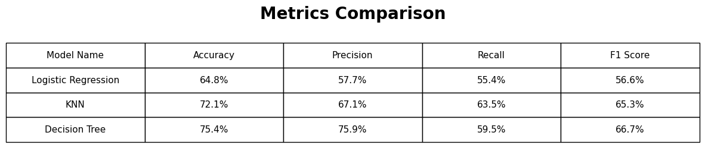
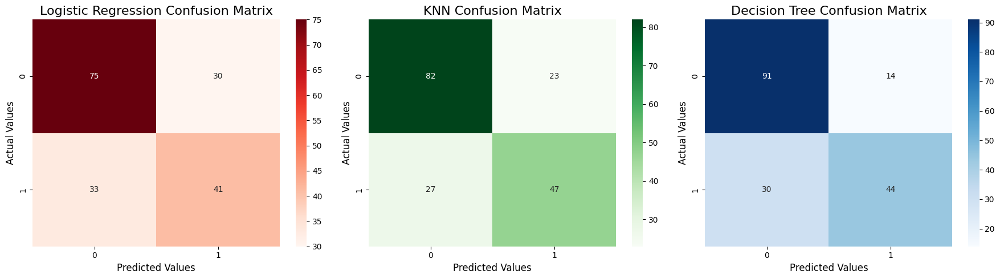
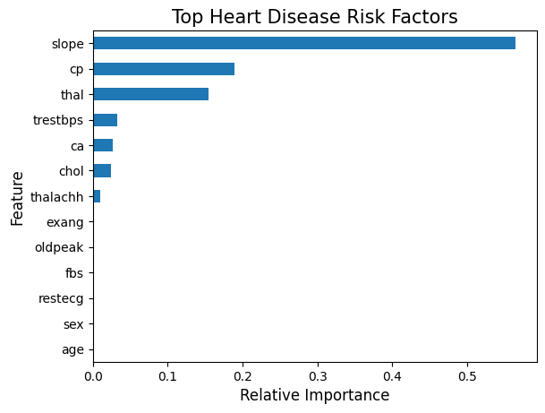
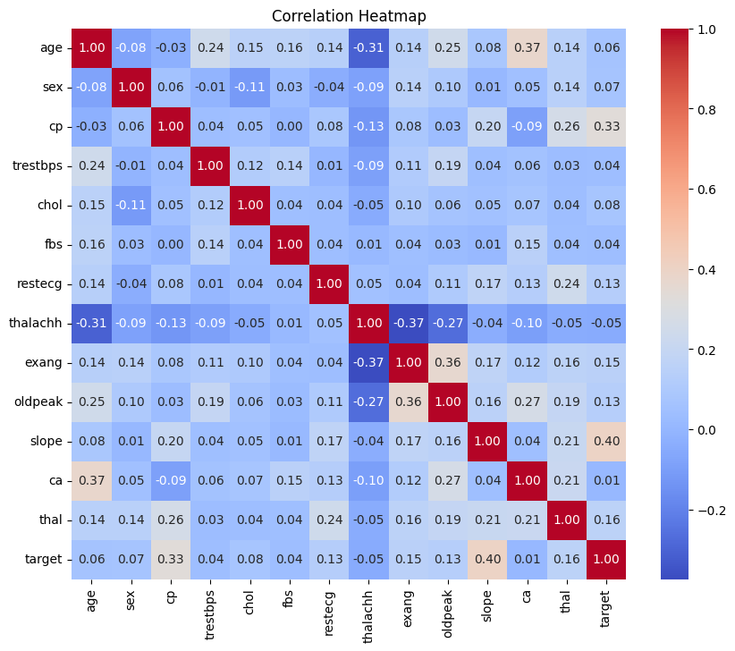

# 🫀 Predicting Heart Disease: 3 Models, 1 Dataset

## 📌 Project Overview
This project builds an end-to-end machine learning pipeline to predict the likelihood of heart disease in patients based on their medical attributes. The goal is to demonstrate clean data preprocessing, feature engineering, and a head-to-head performance comparison of three supervised classification algorithms: **Logistic Regression, K-Nearest Neighbors (KNN), and Decision Trees**.

## 🛠️ Tech Stack & Workflow
* **Language:** Python
* **Libraries:** Pandas, NumPy, Scikit-Learn, Matplotlib, Seaborn
* **Data Preprocessing:** Handled missing values using **median imputation** (to preserve mathematical distributions) and applied `StandardScaler` to normalize features for distance-based algorithms.

---

## 📊 Results & Model Comparison

After evaluating the models on unseen test data, the **Decision Tree Classifier (pruned to a max depth of 4)** emerged as the winning model, achieving the highest Accuracy and F1-Score.

### Performance Metrics


### Model Evaluation (Confusion Matrices)
*Visualizing the True Positives vs. False Negatives across all three algorithms.*


---

## 🧬 Key Data Insights

### Top Heart Disease Risk Factors
By extracting the `feature_importances_` from the winning Decision Tree, we identified which medical attributes most heavily influence heart disease risk in this dataset (with 'slope', 'chest pain type', and 'thal' ranking the highest):


### Feature Correlation


---

## 🚀 How to Run the Code

1. Clone this repository to your local machine:
   ```bash
   git clone [https://github.com/your-username/Heart-Disease-Prediction.git](https://github.com/your-username/Heart-Disease-Prediction.git)
